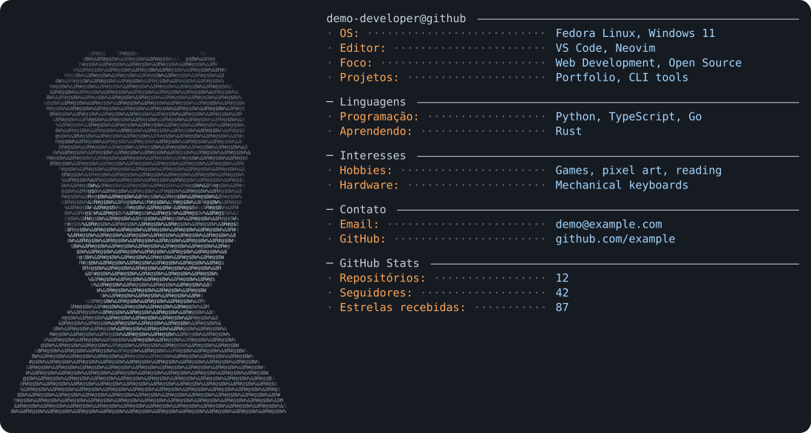

# ASCII Profile Studio 3.0 — Retrato ASCII detalhado

Editor local para criar cartões de perfil do GitHub em **SVG editável**, com o **seu retrato em ASCII**, campos livres e visual de terminal. Inspirado no estilo do [Andrew6rant](https://github.com/Andrew6rant/Andrew6rant), com código próprio. **Não utiliza IA generativa nem envia a foto para serviços externos.**



## Novidade da versão 3.0 — retrato ASCII detalhado

Esta versão permite retratos detalhados em ASCII a partir de fotos com os olhos visíveis. **A distribuição pública inclui apenas um avatar fictício ilustrado**, sem fotografias pessoais. Os arquivos de demonstração estão em `assets/foto-original.jpg` e `assets/retrato_fiel.png`; você pode substituí-los pela sua própria imagem no editor.

O novo modo **Retrato realista em ASCII** usa uma grade de aproximadamente 94 × 72 caracteres. Cada posição é um caractere de verdade (`<text>`/`<tspan>`), com tom calculado da foto original. O arquivo SVG **não contém fotografia embutida, máscaras de foto ou imagem raster**. Pode ser redimensionado sem pixelizar as letras, e a grade é editável como SVG/texto.

Além do cartão completo, há **`output/portrait_only.svg`**, para examinar a semelhança com zoom. O editor ganhou o botão **Baixar retrato ASCII isolado**, além dos SVGs claro/escuro, e controle de **tamanho dos caracteres** na seção Arte ASCII.

O modo novo não remove os três algoritmos anteriores: *Contornos (antigo)*, *Clássico* e *Dithering*. Você pode alternar entre eles a qualquer momento. O preset **Terminal clássico (Andrew)** também passou a adotar o retrato detalhado.

**Limitação real:** ASCII continua sendo uma representação aproximada. A aparência varia com resolução, tipografia, iluminação e distância de visualização. A maior definição permite mais detalhes, mas não garante que o rosto ficará perfeitamente reconhecível; compare primeiro no arquivo isolado e ajuste contraste, recorte, largura e fonte.

### Qual foto funciona melhor?

1. Selfie nítida **sem cobrir os olhos**, com iluminação uniforme.
2. Enquadramento próximo do rosto. Um PNG com fundo transparente facilita preservar só a silhueta.
3. Para fotos com fundo, remova-o antes de fazer o upload; o editor não executa automaticamente uma segmentação perfeita da pessoa.
4. Use largura entre **75 e 110 caracteres**, ajuste a altura proporcionalmente, e controle o tamanho dos caracteres para caber na coluna esquerda.

## Recursos preservados da versão 2.0

- **ASCII com mais detalhe:** quatro métodos — *Detalhado (bordas)*, *Clássico* e *Dithering* —, contraste local, nitidez, brilho, bordas e caracteres customizáveis.
- **Recorte interativo:** visualize a foto no editor, arraste para enquadrar, use zoom e sliders horizontal/vertical. O arquivo original não é destruído.
- **Layout editável:** margem, posição do retrato, largura das colunas, espaço entre colunas, largura dos rótulos, fonte, altura da linha e espaçamento entre seções.
- **Cores funcionais nos dois temas:** personalização de sete cores por tema. Dentro de qualquer valor, `[[+texto]]` aplica a cor de adições e `[[-texto]]` a de remoções. Exemplo: `[[+523.178++]] / [[-76.902--]]`.
- **Prévia fiel à exportação:** os botões de download geram o SVG da **configuração atual**, mesmo que ainda não tenha clicado em Salvar. Para persistir em `output/` e `config.yaml`, clique em **Salvar e gerar SVGs**.
- **Segurança:** servidor ligado em `127.0.0.1`, verificação de Host/Origin e pedidos entre sites, validação de foto e parâmetros, arquivos atômicos e escape/limpeza XML.
- **Editor:** quatro presets (Terminal clássico, Compacto, Neon e Minimalista), desfazer/refazer, arrastar e soltar para reordenar campos e seções, com botões ↑/↓ alternativos.
- **GitHub:** consulta opcional de repositórios públicos, seguidores, estrelas e forks. A Action pode fazer novas consultas todos os dias, caso ative a opção no editor. Dados sem cobertura confiável na API são mostrados como `—`.
- **Testes:** suíte ampliada de validação SVG, API local, segurança, fotos, recortes e estatísticas (offline, sem depender do GitHub).

Os arquivos da versão anterior foram preservados na pasta [`original_reference/`](original_reference/), inclusive gerador e configuração da v2.1 e uma prévia anterior.

## Iniciar no Fedora

Extraia o ZIP, abra um terminal na pasta do projeto e execute:

```bash
./iniciar-fedora.sh
```

O script prepara um ambiente virtual Python, instala as dependências e inicia o editor. Depois acesse:

**http://127.0.0.1:8765**

Instalação manual (Linux/macOS):

```bash
python3 -m venv .venv
source .venv/bin/activate
python -m pip install -r requirements.txt
python app.py
```

Windows PowerShell:

```powershell
py -m venv .venv
.venv\Scripts\Activate.ps1
pip install -r requirements.txt
python app.py
```

Também pode gerar sem abrir o editor:

```bash
python generator.py
python generator.py --dark-only
```

**Importante:** o editor é uma aplicação **local**, sem login e sem exposição à internet. Não use `--allow-remote` em redes públicas. A opção de rede é apenas para usuários avançados que entendam os riscos.

## Usar o editor

### Foto e ASCII

1. Abra o editor e selecione um PNG, JPEG ou WebP do seu computador. Não precisa trocar o avatar do seu GitHub.
2. Arraste o recorte na foto. Use o slider de **Zoom** e os controles de posição. A foto pode ser transparente.
3. Comece pelo modo `Retrato realista em ASCII`. Os modos antigos `Contornos`, `Clássico` e `Dithering` também continuam disponíveis.
4. Ajuste largura e altura da arte ASCII, contraste, nitidez e **tamanho dos caracteres**. Abra o retrato isolado em tamanho grande antes de decidir. Sua foto está em `assets/`.

### Campos e seções

Os campos são livres. Um trecho de `config.yaml` pode ser:

```yaml
sections:
  - title: ''
    rows:
      - label: OS
        value: Fedora Linux
      - label: Projetos
        value: Criando ferramentas de IA
  - title: GitHub Stats
    rows:
      - label: Repositórios
        value: '{{github.public_repos}}'
      - label: Seguidores
        value: '{{github.followers}}'
```

Você pode remover qualquer linha (por exemplo `Uptime`) ou trocar rótulos e valores. Campos longos quebram a linha automaticamente. O YAML suporta igualmente fotos, temas, layout e configurações do GitHub.

Para destacar valores com cores distintas, use no campo:

```text
Linhas alteradas: [[+523.178++]] / [[-76.902--]]
```

### Presets, desfazer e reordenar

Trocar um preset modifica **aparência e dimensões**, sem apagar seus campos nem trocar sua foto. **Desfazer** e **Refazer** funcionam nos botões do topo ou com `Ctrl+Z`/`Ctrl+Shift+Z`. Durante digitação rápida, alterações próximas são agrupadas no histórico. Arraste pelas alças `⠿` ou use ↑/↓ se preferir.

### Salvar e baixar

- **Baixar SVG escuro/claro:** baixa o estado atual do editor, incluindo alterações não salvas.
- **Salvar e gerar SVGs:** grava `config.yaml`, `output/dark_mode.svg`, `output/light_mode.svg` e `output/portrait_only.svg`.
- **Baixar retrato ASCII isolado:** exporta o retrato no estado atual, sem o painel de informações.
- **Prévia:** atualizada automaticamente; alterações não salvas são sinalizadas.

## Estatísticas reais do GitHub

O botão **Buscar estatísticas agora** coleta somente dados públicos do usuário configurado: repositórios públicos, seguidores e, quando foi possível enumerar todos os repositórios, somatório de estrelas e forks dos repositórios próprios **não derivados de forks**. A consulta de estrelas/forks é limitada a usuários com até 1000 repositórios públicos para não reportar somas incompletas. Para usuários com mais repositórios, esses dois campos retornam `—`.

O editor acrescenta campos usando referências como `{{github.public_repos}}`. O cache está armazenado no próprio `config.yaml` e é utilizado na geração offline. Você pode reescrever os valores manualmente, removê-los ou mudar o rótulo. Os campos indisponíveis não recebem números fabricados: commits históricos, contribuições totais e linhas de código **não** são consultados pela API pública dessa implementação.

### Atualização automática (opcional)

1. Informe seu usuário GitHub real no editor.
2. Marque **Atualizar estatísticas automaticamente nas GitHub Actions** e clique em **Salvar e gerar SVGs**.
3. Publique o projeto em um repositório GitHub com Actions habilitadas (workflow em `.github/workflows/generate.yml`).
4. A Action será executada nos pushes relevantes, manualmente ou **diariamente às 07:17 UTC**. Ao executar `python generator.py --refresh-stats`, atualizará `github.cached` e os dois SVGs.
5. A Action utiliza `GITHUB_TOKEN` fornecido automaticamente pelo GitHub Actions. Não coloque tokens em `config.yaml` nem publique credenciais.

**Observação:** para ser exibido no perfil, os SVGs precisam estar no repositório do perfil. Se o seu projeto de gerador e o README de perfil estiverem em repositórios diferentes, a Action **não copia os arquivos entre eles**. Copie-os manualmente ou configure sua própria automação de publicação.

A execução agendada ocorre na branch padrão do repositório; o workflow está configurado para a branch `main`. Em repositórios novos, confirme que é essa a sua branch.

## Mostrar o resultado no README do perfil

Crie o repositório público `usuario/usuario` (com o mesmo nome do seu perfil) e adicione os SVGs dentro da pasta `output/`. Cole o conteúdo de [`README_PROFILE_TEMPLATE.md`](README_PROFILE_TEMPLATE.md) no `README.md` desse repositório. O GitHub trocará a imagem conforme o tema claro/escuro.

## Estrutura

```text
ascii-profile-studio/
├── app.py                  # servidor/editor local
├── generator.py            # imagem, ASCII, SVG e opções
├── github_stats.py         # consulta de estatísticas públicas
├── config.yaml             # configurações e campos editáveis
├── static/
│   ├── index.html          # marcação da interface
│   ├── style.css           # visual da interface
│   └── app.js              # interatividade, crop, histórico, drag/drop
├── assets/                 # imagens fictícias de exemplo; uploads locais
├── output/                 # cartões SVG escuro/claro, retrato isolado e prévias
├── tests/                  # testes automatizados
├── original_reference/     # cópia do projeto anterior
├── .github/workflows/      # atualização automática opcional
└── README_PROFILE_TEMPLATE.md
```

## Testes

```bash
python -m unittest discover -s tests -v
```

Testes de API usam um servidor local com porta temporária. Testes de estatísticas usam respostas simuladas da API do GitHub, para não depender de conexão externa.

## Privacidade e segurança

- A foto nunca é enviada a serviços de IA. Uploads do editor ficam no seu próprio projeto, em `assets/uploads/`.
- Ao publicar todo o projeto depois de personalizá-lo, **suas fotos e `config.yaml` se tornarão públicos**. Uma opção é publicar somente os SVGs em um repositório de perfil, mantendo o gerador e sua foto privados.
- O servidor web é pensado para uso **local**. Não o exponha na internet. Não há autenticação de usuários.
- Usamos SVG de texto e elementos seguros, sem `foreignObject`, imagens remotas, scripts ou fontes externas.
- Você pode editar código-fonte e configuração livremente. O resultado da foto depende da iluminação e qualidade da imagem original.

## Licença

MIT, consulte [`LICENSE`](LICENSE). A licença do código não altera os direitos sobre as fotografias pessoais contidas em `assets/`.
