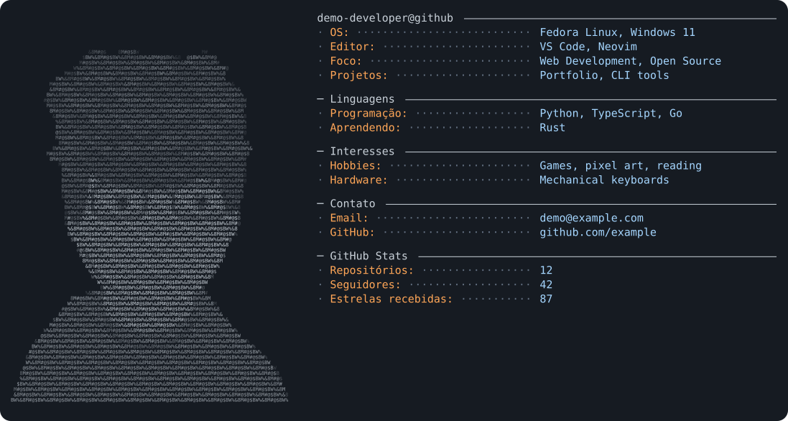

<!-- Copie este trecho para o README.md do repositório cujo nome é igual ao seu username. -->

  <picture>
    <source media="(prefers-color-scheme: dark)" srcset="output/dark_mode.svg" />
    <source media="(prefers-color-scheme: light)" srcset="output/light_mode.svg" />
    
  </picture>

